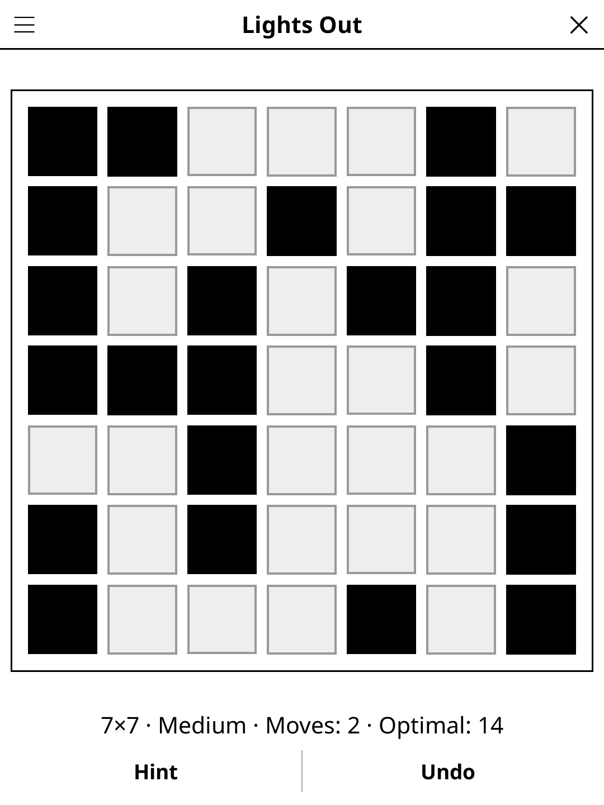

# lightsout.koplugin

Lights Out for [KOReader](https://github.com/koreader/koreader).

## Screenshot

## Rules

Switch every light off. Tapping a cell switches it and its four orthogonal
neighbours: lit cells go dark and dark cells light up. Lit cells are black.

## Features

- **Five sizes** — 5×5 to 9×9
- **Always solvable** — each puzzle is made by pressing random cells of a
  dark board
- **Three difficulty levels** — Easy and Medium press a few random cells
  (about n and 2n); Hard is a uniformly random solvable board
- **Optimal press count** shown for every puzzle, computed by linear algebra
  over GF(2) (Gaussian elimination, then the smallest solution among those
  the null space allows: 4 on 5×5, 256 on 9×9)
- **Any solution wins** — the goal is simply a dark board
- **Hint** — two taps: the first points at a cell of an optimal solution from
  the current board, the second presses it. Following hints from the start
  solves in exactly the optimal number of moves
- **Show solution** — rings on every cell of an optimal solution, updated as
  you play
- **Undo, Restart**, move counter and best per size and difficulty (rounds
  without hints)
- **Auto-save** — the game is restored on next launch

## Controls

| Action | How |
|--------|-----|
| Press a cell | Tap it |
| Hint, Undo | Action bar |
| New game, size, difficulty, solution, restart, rules | Title-bar menu |

## Why e-ink friendly?

Turn-based, no animation; black and pale grey cells give the strongest
contrast an e-ink panel has.

## License

GPL-3.0 — see [LICENSE](LICENSE).
